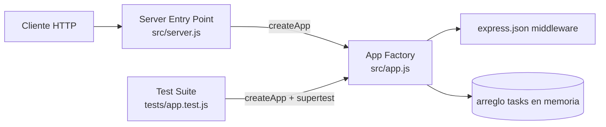
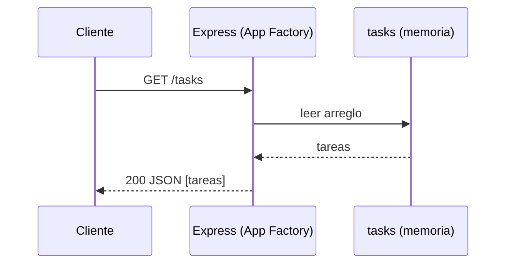
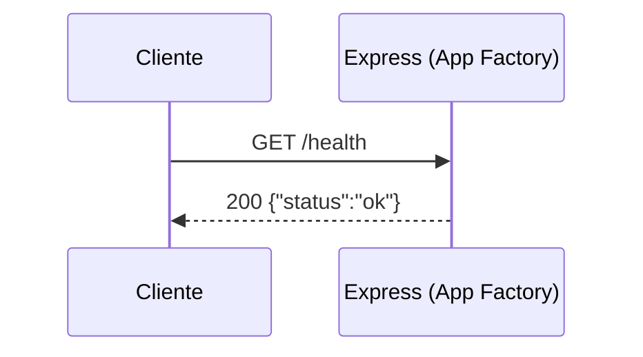
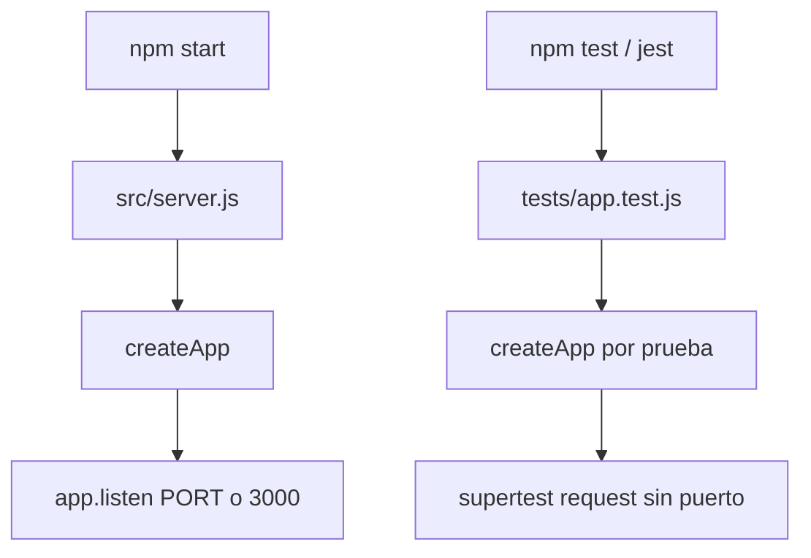

# Arquitectura

## Architecture Analysis

### System Overview
Servicio HTTP monolítico de un solo proceso Node.js. `src/server.js` crea la aplicación mediante la fábrica `createApp()` de `src/app.js` y la pone a escuchar en `process.env.PORT` (por defecto 3000). Todo el estado vive en memoria dentro del cierre (closure) de cada instancia de la app.

### Architectural Style
Monolito mínimo con patrón **App Factory** (Express): la definición de rutas está separada del arranque del servidor, lo que permite a las pruebas crear instancias aisladas con Supertest sin abrir un puerto. No hay capas separadas (controlador/servicio/repositorio): los manejadores de ruta acceden directamente al arreglo `tasks`.

### Component Relationships

Texto alternativo: el cliente HTTP llega a `src/server.js`, que obtiene la app de `createApp()` en `src/app.js`. Las pruebas usan `createApp()` directamente vía Supertest. La app registra el middleware `express.json()` y lee/escribe un arreglo `tasks` en memoria propio de cada instancia.

### Data Flow
Petición HTTP → `express.json()` (parsea cuerpo JSON) → manejador de ruta → lectura del arreglo `tasks` → respuesta JSON (`res.json`). No hay base de datos, caché ni llamadas externas.

### Key Design Decisions
- **Fábrica en lugar de singleton**: aislamiento por instancia (cada prueba obtiene un `tasks` vacío). Implicación: cualquier estado nuevo (p. ej. contador de `id`) debe declararse dentro de `createApp()`.
- **Persistencia en memoria**: simplicidad para la práctica; los datos se pierden al reiniciar.
- **Sin manejador de errores propio**: los errores caen en el manejador por defecto de Express (respuesta HTML).

### Improvement Opportunities
- Añadir un middleware de errores que devuelva el formato `{ "error": "..." }` (incluido el JSON malformado de `express.json()`), alineado con `feature.md`.
- Extraer validación a una función pura si crece el número de reglas.
Deuda técnica completa en [code-quality-assessment.md](code-quality-assessment.md).

## Interaction Diagrams

### GET /tasks (existente)

Texto alternativo: el cliente pide `GET /tasks`; la app lee el arreglo en memoria y responde 200 con la lista (en la línea base, `[]`).

### GET /health (existente)

Texto alternativo: el cliente pide `GET /health` y la app responde 200 con `{ "status": "ok" }` sin tocar el almacenamiento.

### Arranque y pruebas

Texto alternativo: `npm start` ejecuta `src/server.js`, que llama a `createApp()` y escucha en el puerto. `npm test` ejecuta Jest, que carga `tests/app.test.js`; cada prueba crea su propia app y la consulta con Supertest sin abrir un puerto.

Los flujos de `POST /tasks` y `GET /tasks/:id` aún no existen (ver `feature.md` y [business-overview.md](business-overview.md)).
